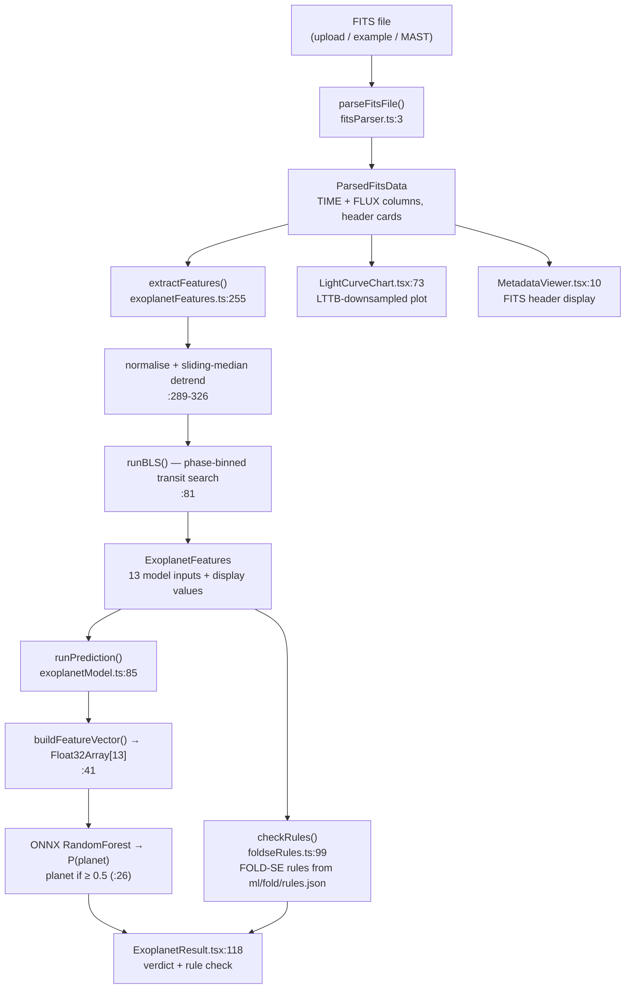

# ExoScope — Architecture

How the code actually works, mapped to real files and line numbers.

This document describes **what is in the repository**, verified by running it.
Where a behaviour is wrong or a claim is unproven, it says so. If this file ever
disagrees with the code, the code wins — fix this file.

---

## What it does

A telescope records how bright a star is, over and over, for months. That
recording is a **light curve**. If a planet orbits the star and its orbit is
edge-on from our viewpoint, the planet passes in front of the star and the
brightness dips by a fraction of a percent for a few hours, then repeats every
orbit. That repeating dip is a **transit**.

ExoScope takes a Kepler light curve file, searches it for a repeating dip,
estimates whether that dip looks like a planet, and shows readable rules that
explain the call. Everything runs in the browser — the FITS file is never
uploaded anywhere.

---

## Pipeline



Orchestration is `handleDataLoaded` in [`App.tsx:410`](App.tsx). All three entry
points — upload, example buttons, archive search — call it with the same
`ParsedFitsData`.

---

## Step 1 — Read the FITS file

**`utils/fitsParser.ts`** (311 lines)

FITS is a 1980s astronomy container format: fixed 2880-byte blocks, an ASCII
header of 80-character "cards", then a binary table.

| Function | Line | Does |
|---|---|---|
| `parseFitsFile` | 3 | Walks HDUs until it finds the `BINTABLE` extension |
| `parseHeaderUnit` | 94 | Reads 80-char cards, handles `''` quote escaping |
| `parseColumnDefinitions` | 202 | Reads `TFORM`/`TTYPE`, computes byte offsets |
| `readBinaryTable` | 269 | Big-endian reads of each column, `NaN` → `null` |

Numbers are big-endian (`getFloat64(pos, false)`). Kepler marks bad cadences as
`NaN`, which becomes `null` and is filtered downstream.

**Verified working.** Parsing a real `kplr002445129-2009166043257_llc.fits`
downloaded live from MAST reads all 20 columns in ~2 ms, and the stellar values
it pulls from the header (`TEFF=5927`, `RADIUS=1.06`) match the NASA catalog
entry for that star exactly.

Caveats: `TSCALn`/`TZEROn` column scaling is not applied (Kepler light curves
don't use it); columns with `TFORM` repeat > 1 are skipped but still counted for
byte alignment; there's no check that the file starts with `SIMPLE  =`, so a
non-FITS upload produces a confusing error rather than a clear one.

---

## Step 2 — Clean up the brightness data

**`utils/exoplanetFeatures.ts:255-326`** (`extractFeatures`)

1. Keep rows where TIME and FLUX are both present and flux > 0 (`:265-270`)
2. Sort by time (`:274-276`)
3. Divide by the median so out-of-transit sits at 1.0 (`:289-291`)
4. Downsample to at most 15,000 points (`MAX_PTS`, `:296`)
5. **Detrend** with a sliding median over a 0.75-day window (`:300-315`)
6. Clip points more than 4σ from 1.0 (`:317-326`)

Step 5 is the important one. Stars are intrinsically variable — spots and
rotation cause slow brightness swings much larger than a transit. Dividing by a
local median over a window *longer than a transit but shorter than stellar
rotation* flattens the slow variation while leaving the sharp dip intact.

Tradeoff: transits longer than about 9 hours start contaminating their own
median window, which suppresses the measured depth.

---

## Step 3 — Search for a repeating dip (BLS)

**`utils/exoplanetFeatures.ts:81-238`** (`runBLS`)

A transit is defined by three unknowns that must be found *together*:
**period** (how often), **duration** (how long), **epoch** (when it happens).
BLS — Box Least Squares — searches combinations of all three, scoring each by
how much dimmer the in-transit points are than the rest:

```
depth = mean(out) − mean(in)
power = depth · √(N_in) / σ
```

Rather than rescan every data point for every trial, the search folds the light
curve into `N_BINS = 400` phase bins once per trial period, then evaluates every
(duration, epoch) pair against those bins using prefix sums — O(1) per pair.
Bins are duplicated end-to-end before the prefix pass so a transit straddling
phase 1.0 → 0.0 is still one contiguous slice, with no branch in the hot loop.

Three passes:

| Pass | Trials | Purpose |
|---|---|---|
| 1. Coarse | 500 log-spaced periods, 0.3 d → min(baseline × 0.49, 500 d) | Locate the neighbourhood |
| 2. Refine | 50–400 periods in a ±3% window | Pin the period precisely |
| 3. Sub-harmonic | P/2 and P/3, each refined | Reject 2:1 and 3:1 aliases |

Pass 2 exists because the coarse grid alone lands ~1% off, and small period
errors compound: on KIC 3115833 a 0.0195 d offset accumulates to 1.16× the
transit duration across 8.7 orbits, smearing the transits out of the window.
The step size is chosen so drift over the full baseline stays under 10% of one
transit duration.

Pass 3 exists because a real transit at period P also produces power at 2P and
3P — folding at a multiple still stacks a subset of transits coherently — and a
coarse grid actively *favours* the alias, since longer periods fit fewer cycles
into the baseline and so accumulate less drift from grid error. Without this
pass the search reports 20.360 d for KIC 3115833, exactly twice the truth. A
genuinely long-period planet is unaffected: no transits exist at the halved
spacing, so the sub-harmonic simply scores worse and loses.

Measured on the bundled `KIC 3115833` example (true period 10.1816 d):

| | Period found | SNR | Search time |
|---|---|---|---|
| Previous 1000 × 12 × 20 scan | 7.99 d | 4.80 | 8,689 ms |
| Current binned search | **10.1808 d** | **10.60** | **107 ms** |

`DUR_FRACS`, the minimum point counts (≥3 in, ≥10 out), and the `power` formula
are unchanged from the previous implementation. The SNR no longer affects the
verdict (see Step 5).

---

## Step 4 — Classify

**`utils/exoplanetModel.ts`** (153 lines)

`buildFeatureVector` (`:41`) packs 13 numbers, in this exact order:

```
0  period_days          4  stellar_logg          8  log_depth
1  transit_depth_ppm    5  stellar_radius_rsun   9  log_period
2  transit_duration_hr  6  depth_per_hr         10  log_duration
3  stellar_teff_k       7  duty_cycle           11  depth × logg
                                                12  period ÷ stellar_radius
```

Stellar values come from the FITS header (`TEFF`, `LOGG`, `RADIUS`), falling
back to solar values (5778 K, 4.44, 1.0) when absent — `:278-283` of
`exoplanetFeatures.ts`. `assumed_star_values` records which ones were filled
in, and the result page says so. Every one of the 170 MAST files in
`ml/benchmark/` has all three; the two bundled example files have them
stripped, so they run on solar defaults.

### What the model actually is

Verified by parsing `public/model/exoscope_model.onnx` directly:

| Property | Value |
|---|---|
| Graph | `Imputer → Scaler → TreeEnsembleClassifier` |
| Algorithm | **RandomForest** (`post_transform=NONE`, leaf weights are multiples of 1/150) |
| Trees | **150** |
| Inputs | 13 float32 |
| Outputs | `label`, `probabilities` (shape `[N,2]`) |
| Exported by | skl2onnx 1.20.0 |

Trained on **7,586 rows** of `ml/koi_cumulative.csv` — every entry dispositioned
`CONFIRMED` (2,747) or `FALSE POSITIVE` (4,839); `CANDIDATE` rows are excluded.
Confirmed by comparing the ONNX `Scaler` offsets against column means computed
from that CSV: `koi_period` 51.65589, `koi_duration` 5.71288, `duty_cycle`
0.04789 — matching to five decimal places.

> **`ml/train_model.py` does not reproduce this model.** It builds 10 features
> and a `GradientBoostingClassifier`; the shipped model has 13 features and is a
> 150-tree RandomForest. The script that produced `exoscope_model.onnx` is not in
> the repository. Retraining requires reconstructing it first.

> `ml/feature_config.json` and `public/model/feature_config.json` are **not read
> by the application**. Their `threshold: 0.25` has no effect; the live cutoff is
> `PLANET_CUTOFF = 0.5` in `exoplanetModel.ts`.

---

## Step 5 — Decide

**`utils/exoplanetModel.ts:85`** (`runPrediction`)

```
planetProbability = forest's P(planet)
verdict           = planetProbability ≥ 0.5     // PLANET_CUTOFF, :26
```

The verdict used to be `0.6 · sigmoid(SNR) + 0.4 · P(planet) ≥ 0.45`. Measured
on 170 real Kepler quarters ([`ml/benchmark/`](ml/benchmark/)), the SNR ranks
false positives above planets (AUC 0.413, against 0.813 for the forest),
because eclipsing binaries make deeper dips. The blend got 59.4% right; the
forest alone at 50% gets 73.5%. Tuning the cutoff on half the files and
scoring the other half only reached about 74.6%, so 50% stays.

---

## Step 6 — Explain

**`utils/foldseRules.ts`** (`checkRules`, `:99`)

The rules learned by FOLD-SE ([`ml/fold/`](ml/fold/)) are imported from
`ml/fold/rules.json` at build time and run on the same measurements the forest
saw. `checkRules` records every condition (measured value, cutoff, holds or
not) for the main rule and each exception, and `ExoplanetResult.tsx` lists
them under "Why the rule check says…".

The logic follows FOLD-SE's: a signal is a planet when every condition of the
main rule holds and no exception applies. A missing value fails an "at most"
or "more than" check but passes a "not at most" (`!=<`) check, as in FOLD-SE.
On the 170 benchmark files, `checkRules` gives the same answer as an
independent Python implementation on every file.

The page shows the forest's answer, the rule check's answer, and whether they
agree. On the benchmark they disagree on 43 files and the forest is right on
28, so the forest makes the call and the rules explain it. The panel states
the rules' accuracy on both sources: 84.8% on NASA catalog values, 65.9% on
this site's measurements.

After retraining, a new `rules.json` is picked up on the next build; the
accuracy figures in `RULE_RESULTS` (`foldseRules.ts`) need updating by hand.

---

## Repository layout

```
App.tsx                       Root component, animated demo, orchestration (:410)
index.tsx                     React entry point
types.ts                      Shared interfaces
components/
  FileUpload.tsx              Drag-and-drop .fits upload
  ExampleFiles.tsx            Two Kepler files embedded as base64
  ArchiveSearch.tsx           NASA Exoplanet Archive search + MAST fetch
  LightCurveChart.tsx         Flux vs time, LTTB downsampled to 3,000 points
  MetadataViewer.tsx          FITS header display
  ExoplanetResult.tsx         Verdict card, two-model box, rule check
utils/
  fitsParser.ts               FITS binary reader
  exoplanetFeatures.ts        Detrending, BLS, feature computation
  exoplanetModel.ts           ONNX inference + decision
  foldseRules.ts              Runs the FOLD-SE rules and records each check
api/mast.ts                   Vercel serverless proxy for MAST downloads
ml/
  train_model.py              Stale: does not build the shipped model
  koi_cumulative.csv          NASA KOI catalog (9,564 rows)
  exoscope_model.onnx         Copy of the shipped model
  fold/                       FOLD-SE rules, SHAP, Random Forest comparison
  benchmark/                  170-file real-data accuracy test
public/model/                 Model served to the browser
```

`public/ort*` (the onnxruntime-web distribution, ~96 MB) is **gitignored**. The
runtime loads WASM from a CDN, so those files are never served. They existed for
a removed predictor that set `wasmPaths = "/"`.

---

## Known issues

Ordered by impact.

1. **About one file in four is called wrong.** 73.5% on the 170-file
   benchmark. The rules alone get 65.9% on the same files.

2. **Train/serve skew.** The forest and the rules learned from NASA's catalog
   values, measured across the full multi-year mission. At inference they
   receive BLS estimates from a single ~90-day quarter. A forest built like the
   website's scores 87.7% in 5-fold cross-validation on catalog values, against
   73.5% on the benchmark; the rules drop from 84.8% to 65.9%. `duty_cycle`, a
   top feature for both, can only take the 12 values in `DUR_FRACS`, having
   been continuous in training. Both models also only ever saw objects that
   already passed NASA's detection pipeline, so "no signal at all" is outside
   their training data.

3. **The built-in "False Positive" example is called a planet.** In that
   trimmed KIC 2445129 file the search finds a 3.41-day, 513 ppm dip instead of
   NASA's 10.32-day, 872 ppm signal, and both the forest (77%) and the rules
   accept it.

4. **~180 ms UI freeze.** `extractFeatures` is synchronous on the main thread
   (`App.tsx:416`) with no worker and no yields. Not perceptible, but a Web
   Worker would be the correct structure.

5. **Archive search only works on Vercel.** `ArchiveSearch.tsx` requests
   `/api/mast`, implemented as a Vercel function in `api/mast.ts`. In
   `npm run dev` that path returns HTTP 500. `vite.config.ts` already defines a
   working `/mast-proxy` route that nothing calls.

6. **Planet temperature assumes a Sun-mass star** when converting the period to
   an orbit size. It does use the star's own temperature and radius.

7. **`index.html` links `/index.css`, which does not exist** — the build warns
   and the request 404s at runtime. The `importmap` in `index.html` points at
   `aistudiocdn.com` and is overridden by Vite.

---

## Things earlier documentation claimed that are not true

The old README and SETUP.md described designs that never shipped in this form:

| Claim | Reality |
|---|---|
| "Random Forest + Gradient Boosting ensemble" | One RandomForest. No gradient boosting anywhere. |
| "26 features" / "10 features" | 13 |
| "Lomb-Scargle periodogram" | BLS |
| "`rfScore()` / `gbScore()` in TypeScript" | ONNX inference; no such functions |
| "Three physics override rules" | `overridden` is hardcoded `false` |
| "500 trees, max_depth 12" | 150 trees |
| "99.5% / 97.12% accuracy" | Unverifiable; not reproducible from this repo |
| "~80.9% real-world accuracy on 170 files" | Measured since: 73.5% on 170 files (`ml/benchmark/`) |
| "up to 65,000 points" charted | `MAX_DISPLAY_POINTS = 3000` |

The current, reproducible number is **73.5%** on 170 real Kepler quarters
(85 confirmed planets, 85 false positives), measured by running the website's
own code through [`ml/benchmark/`](ml/benchmark/).
